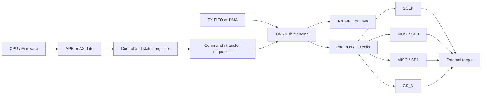
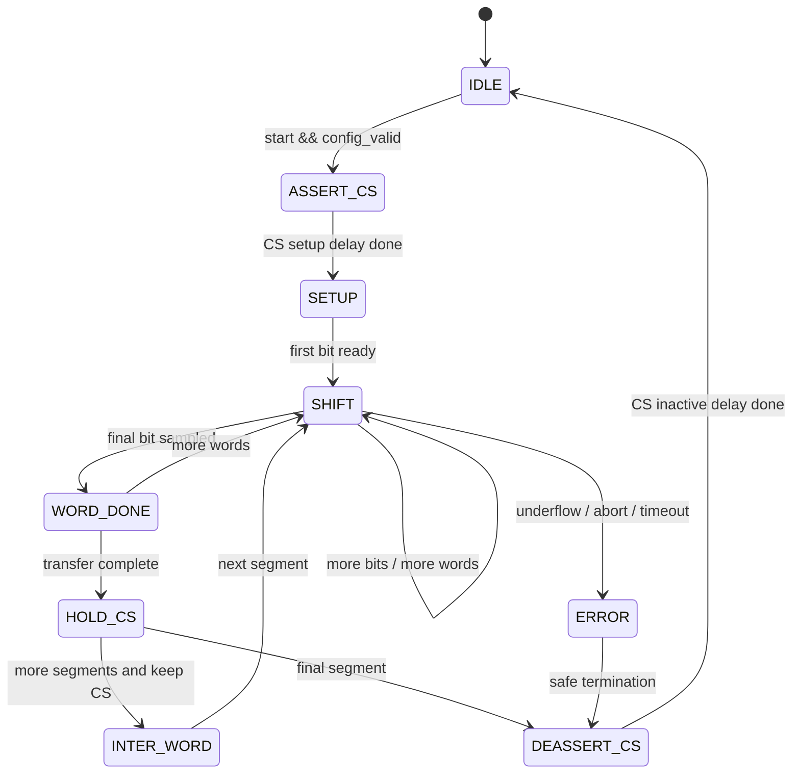

# Lesson 20 — SPI: Protocol, Controller RTL, Flash, QSPI and Silicon Debug

## From four wires and a shift register to high-throughput serial memory

**Curriculum:** SoC IP Masterclass — Basics to Silicon Engineering  
**Session:** 20 of 38  
**Target duration:** 60 minutes  
**Level:** protocol, controller/target RTL, register programming, flash architecture, software, electrical integration and post-silicon validation  
**Prerequisites:** GPIO/pinctrl and pad-ring behavior (Lesson 18), I²C electrical/protocol concepts (Lesson 19), APB/AXI register interfaces, DMA, clock/reset/CDC and interrupt fundamentals

> **Scope discipline:** SPI is a widely implemented de facto interface, not one universally governed protocol specification with a single mandatory packet format or compliance suite. This lesson separates the common synchronous shift interface from target-specific command protocols (for example, serial NOR flash opcodes), and from implementation-specific extensions such as Dual/Quad/Octal SPI. Always use the target data sheet and the controller integration manual as the final authority for mode, timing, command format, lane turnaround and chip-select behavior.

---

## 0. One-hour learning plan

| Time | Topic | Engineering outcome |
|---:|---|---|
| 0–5 min | Why SPI exists; history and trade-offs | Explain the synchronous shift-register model |
| 5–12 min | Signals, topology and electrical behavior | Draw a safe controller/target connection |
| 12–22 min | CPOL/CPHA and four modes | Derive sample and shift edges |
| 22–31 min | Words, transfers, chip select and target commands | Decode a transaction and continuous-CS sequence |
| 31–40 min | Serial NOR, Dual/Quad SPI and SFDP | Follow opcode/address/dummy/data phases |
| 40–47 min | Controller RTL, FIFOs, DMA and register programming | Design a robust controller datapath |
| 47–55 min | Timing, bandwidth and verification | Calculate throughput and build assertions |
| 55–60 min | Silicon debug, interview questions and lab | Diagnose a real board-level failure |

## 1. Why SPI exists

A microcontroller often needs to exchange short, deterministic data transfers with nearby peripherals: ADCs, DACs, sensors, display controllers, codecs, EEPROMs and nonvolatile flash. A parallel interface consumes many pins and requires multiple data wires plus control signals. An asynchronous serial link such as UART saves pins but does not provide a shared sampling clock and is not naturally full duplex at the same instant.

SPI uses a clock driven by the controller, a transmit data path, a receive data path and a target-select signal. The shift-register model is simple: on each active clock edge, one bit can move in each direction. The target is selected out of band by chip select, so the basic bus does not need an address field, acknowledgement bit or arbitration phase.

### 1.1 Historical evidence and design rationale

- **By 1991:** Motorola's M68HC11 Reference Manual, Rev. 3 (copyright 1991), contains a dedicated Synchronous Serial Peripheral Interface chapter. It documents transfer formats, clock phase/polarity controls, a block diagram, pin signals, control/status registers, mode-fault and write-collision errors. This is strong dated evidence of an established on-chip SPI peripheral implementation by that time. It does not, by itself, establish the exact year SPI was invented.
- **Protocol lineage:** Motorola's legacy SPI Block Guide is still cited by the OpenTitan SPI-host documentation as a useful reference for the general controller requirements and CPOL/CPHA definitions.
- **Modern ecosystem:** Linux describes SPI as a common embedded interface and exposes a controller/device/message/transfer driver model. OpenTitan documents SPI as a de facto standard without a single definitive reference or universal compliance criteria.

**Documented facts:** the 1991 Motorola manual documents an integrated SPI module; OpenTitan explicitly describes the interface as de facto rather than formally standardized; Linux has a generalized SPI subsystem.

**Engineering interpretation:** the controller-generated clock and separate chip-select lines are a pragmatic trade-off for short board-level links. They make the datapath easy to implement and permit independent per-target timing, but cost more pins than I²C and leave framing, addressing, command semantics and error detection to each target device.

### 1.2 Why four wires?

| Signal | Direction at controller | Purpose |
|---|---|---|
| SCLK / SCK | Output | Sampling/shift clock |
| MOSI / COPI / SDI | Output | Controller-to-target data |
| MISO / CIPO / SDO | Input | Target-to-controller data |
| CS_N / SS_N | Output, usually active-low | Select one target |

MOSI/MISO are historically common names. Newer documentation may use COPI/CIPO (Controller Out/Peripheral In and Controller In/Peripheral Out). Do not infer pin direction from a name without checking the target data sheet.

Unlike I²C, SPI does not normally use open-drain wired-AND data signaling. Most basic SPI connections use push-pull data and clock drivers. MISO must be high impedance when a target is not selected if multiple targets share the MISO net; confirm this behavior in every target data sheet.

## 2. System architecture



A production controller commonly contains:

1. **Register interface:** configuration, enable, status, interrupt and FIFO windows.
2. **Clock divider:** derives SCLK from a peripheral clock.
3. **Transfer sequencer:** controls chip select, word count, phase, polarity and inter-transfer delays.
4. **TX path:** holding register, FIFO, DMA request or streaming source.
5. **RX path:** shift register, capture register, FIFO and DMA sink.
6. **Pad control:** output enable, pinmux and safe inactive values.
7. **Interrupt/error logic:** completion, FIFO watermarks, overflow, underflow and fault reporting.
8. **Optional flash sequencer:** opcode/address/dummy/data phases, multi-I/O lane control and memory-mapped/XIP support.

A minimal controller can be a pair of shift registers plus a counter and FSM. A high-throughput SoC controller may add deep FIFOs, DMA, command queues, programmable chip-select timing, multi-lane datapaths, XIP address translation and flash-specific acceleration.

## 3. Signals and electrical behavior

### 3.1 SCLK

The controller generates SCLK. Its idle level is selected by CPOL. The target's maximum SCLK, minimum high/low pulse width, input setup/hold, output delay and CS timing are device-specific. A configured controller rate is only a request; the physical board and target timing determine the safe operating point.

### 3.2 MOSI and MISO

For a basic single-lane full-duplex transfer, MOSI and MISO each carry one bit per SCLK cycle. The controller and target shift/capture in opposite phases so the receiver samples a stable bit.

A transfer of one byte therefore consumes eight SCLK cycles. Both directions operate concurrently: sending eight MOSI bits also clocks in eight MISO bits. If the controller has no meaningful transmit payload during a read, it often sends dummy bytes (commonly 0x00 or 0xFF, depending on the device/driver contract) to generate clocks. Dummy TX data is not the same as a protocol-defined dummy clock phase.

### 3.3 CS_N

CS_N is usually active-low, but active-high selection is possible. A target may interpret CS assertion as the beginning of a command and CS deassertion as the end/commit boundary. Some targets require a minimum CS setup time before the first SCLK edge and hold time after the last edge. Others permit CS to remain asserted across multiple software transfers.

**Critical:** a controller must not automatically pulse CS between pieces of a single logical command unless the target protocol allows it. Linux's SPI message model and controller driver have explicit mechanisms for composing transfers and controlling CS continuity.

### 3.4 Shared-bus topology

```text
                 +------ Target A (MISO tri-state when deselected)
Controller       |
 SCLK -----------+------ Target B
 MOSI -----------+------ Target C
 MISO <----------+------ Shared return line
 CS_A -----------+------ Target A select
 CS_B -----------+------ Target B select
 CS_C -----------+------ Target C select
```

- SCLK and MOSI can be shared.
- Each target usually has its own CS_N.
- MISO outputs must not contend when multiple targets share the return line.
- If targets do not release MISO when deselected, use a mux/buffer or separate controller ports.
- A daisy-chain topology exists for some shift-register-like devices, but it is not a universal SPI feature.
- Multiple controllers require an explicit board/system arbitration or mux strategy. Basic SPI has no standard multi-controller arbitration mechanism comparable to I²C.

## 4. CPOL and CPHA — the four SPI modes

The controller and target must agree on both settings.

- **CPOL (clock polarity):** SCLK idle level. CPOL=0 means idle-low; CPOL=1 means idle-high.
- **CPHA (clock phase):** selects whether data is sampled on the first (leading) or second (trailing) edge of the clock cycle.
- **Leading edge:** first transition away from the idle level.
- **Trailing edge:** transition back toward the idle level.

| SPI mode | CPOL | CPHA | Idle SCLK | Leading edge | Trailing edge |
|---:|---:|---:|---|---|---|
| 0 | 0 | 0 | Low | Rising: sample | Falling: shift/setup |
| 1 | 0 | 1 | Low | Rising: shift/setup | Falling: sample |
| 2 | 1 | 0 | High | Falling: sample | Rising: shift/setup |
| 3 | 1 | 1 | High | Falling: shift/setup | Rising: sample |

The exact first-bit launch behavior is important:

- **CPHA=0:** the first data bit must already be valid before the first leading edge. The first leading edge samples it. Subsequent bits are normally changed on trailing edges.
- **CPHA=1:** the first leading edge is used to shift/launch the first bit; the trailing edge samples it. Subsequent bits follow the same alternating pattern.

This is why CPHA=0 and CPHA=1 are not merely inversions of the clock. They alter the half-cycle relationship between data launch and capture.

### 4.1 Conceptual timing example: Mode 0

```text
CS_N   ‾‾‾‾\________________________________/‾‾‾
SCLK   ______/‾\_/‾\_/‾\_/‾\_/‾\_/‾\_/‾\____
MOSI   ----< b7 >--< b6 >--< b5 > ... < b0 >----
             ^     ^     ^                 ^
           sample on rising edges
```

The diagram is conceptual and not to scale. For Mode 0, the controller makes the first MOSI bit valid before the first rising edge; the target samples on rising edges. The controller can change the next bit on falling edges.

### 4.2 Common mode bug

A target configured for Mode 3 connected to a controller configured for Mode 0 can produce plausible but shifted/corrupted data. A logic analyzer may decode bytes differently depending on its own CPOL/CPHA setting. First verify the actual SCLK idle level and the target's documented sampling edge, then configure the analyzer.

## 5. Transfer and framing model

SPI defines the bit-shifting mechanism, not one universal packet format.

A common transfer is:

```text
CS_N:  ───\________________________________/───
SCLK:       8 clocks       8 clocks
MOSI:       command byte  data/address byte
MISO:       status/old data/response bits
```

At the controller level, a transfer is often represented by:

- TX buffer pointer (optional)
- RX buffer pointer (optional)
- Number of bits/bytes
- Bits per word
- SCLK rate
- CPOL/CPHA mode
- Bit order
- Chip-select identity and CS behavior
- Optional delays before/after transfer or between words

**There is no generic SPI ACK bit.** The controller cannot assume that a byte was accepted merely because it shifted out. Device-specific status reads, CRCs, echoed identifiers or command completion polling may be required.

### 5.1 Full-duplex, transmit-only and receive-only

| Software intent | MOSI behavior | MISO behavior |
|---|---|---|
| Full duplex | Sends TX payload | Captures RX payload |
| Transmit-only | Sends payload | Captured data may be discarded |
| Receive-only | Sends dummy clocks/data | Captures target response |
| Half duplex | Direction changes by phase | Shared bidirectional data line on some 3-wire devices |

Some controller IPs always shift both ways and let software ignore one side. Others provide explicit TX-only/RX-only modes. A 3-wire SDIO target needs direction turnaround and output-enable control; it is not equivalent to a four-wire full-duplex transfer.

### 5.2 Word width and bit order

Eight-bit words are common, but 4-, 9-, 12-, 16- or other word lengths may be supported. MSB-first is common but not universal. Software buffer packing and hardware shift order must agree. Linux exposes bits-per-word and LSB-first configuration where supported.

## 6. Serial NOR flash: a target-specific command protocol

Serial NOR is an excellent example because a simple SPI wire protocol carries a richer device command protocol.

A common command may contain:

1. Opcode.
2. Address bytes.
3. Mode bits or command-specific fields.
4. Dummy clocks.
5. Data payload.

These fields and their ordering are device/command specific.

### 6.1 Typical command examples

The following are common serial-NOR command values, but they must be checked against the exact flash data sheet and SFDP capabilities:

| Operation | Common opcode | Purpose |
|---|---:|---|
| Read data | 0x03 | Read array data |
| Fast read | 0x0B | Read with dummy clocks |
| Write enable | 0x06 | Set write-enable latch |
| Read status register | 0x05 | Poll WIP/WEL/protection bits |
| Page program | 0x02 | Program a page/partial page |
| Sector erase | often 0x20 | Erase a small sector |
| Read JEDEC ID | often 0x9F | Read manufacturer/device ID |
| Read SFDP | often 0x5A | Read parameter tables |

Do not assume all flashes use identical opcodes, address widths, status-bit definitions, page sizes, erase sizes or reset sequences.

### 6.2 Example: read 16 bytes at address 0x001234

Illustrative 24-bit-address, single-lane read:

```text
CS_N low
MOSI: 0x03 | 0x00 | 0x12 | 0x34 | dummy clocks/data...
MISO: X    | X    | X    | X    | D0 D1 ... D15
CS_N high
```

For this common simple-read command, the target interprets the opcode and address, then returns data. The controller must keep CS asserted across opcode, address and read clocks. A target may require a different command for larger address spaces or different read modes.

### 6.3 Page program sequence

A typical page-program workflow is:

1. Read status and ensure the device is not busy.
2. Issue Write Enable (WREN).
3. Issue Page Program opcode and address plus payload while CS remains asserted.
4. Deassert CS to terminate the command.
5. Poll status until Write-In-Progress (WIP) clears, subject to a timeout.
6. Read back and verify the programmed bytes.

NOR flash programming generally changes bits in the 1-to-0 direction; erase restores the relevant erase region to 1s. Page-boundary crossing behavior is device-specific: some devices wrap within a page rather than continuing into the next page. Software should split writes according to the device page size and never infer behavior from the SPI bus alone.

### 6.4 SFDP and ecosystem interoperability

JEDEC JESD216 Serial Flash Discoverable Parameters (SFDP) provides standardized read-only parameter tables describing many serial NOR capabilities. Linux's SPI-NOR framework reads SFDP to discover supported read protocols, erase types, geometry and other capabilities. Vendor-specific quirks may still require fixups.

This is an important ecosystem evolution: the SPI electrical interface remains simple, while a standardized discovery layer reduces the need for hard-coded per-part tables. SFDP does not make every flash command identical; it describes capabilities and parameters.

## 7. Dual, Quad and Octal SPI

Multi-I/O flash interfaces increase data throughput by transferring multiple bits per clock.

| Protocol phase | 1-1-1 | 1-1-4 | 1-4-4 | 8D-8D-8D (example) |
|---|---|---|---|---|
| Instruction | 1 line | 1 line | 1 line | 8 lines |
| Address | 1 line | 1 line | 4 lines | 8 lines |
| Data | 1 line | 4 lines | 4 lines | 8 lines, possibly DTR |
| Extra signals | SCLK/CS | IO2/IO3 reused | IO2/IO3 reused | May include DQS |

The notation is commonly interpreted as instruction-address-data lane widths. Exact protocol notation and DDR support depend on the device/controller ecosystem.

- **Dual SPI:** two data lines during supported phases.
- **Quad SPI (QSPI):** four bidirectional data lines, often IO0–IO3.
- **Octal SPI:** eight data lines, often with additional strobe/timing features in higher-performance variants.
- **STR:** one data transfer per clock cycle (single transfer rate).
- **DTR/DDR:** data transfer on both clock edges, where supported.

A controller must change pin direction safely between transmit, dummy and receive phases. Bus turnaround is a real electrical event: the controller must stop driving lines before the target drives them, and vice versa.

### 7.1 Memory-mapped and execute-in-place (XIP)

Some SoCs map external serial flash into a CPU-visible address window. A flash controller then translates CPU reads into serial command/address/data transactions and may cache/prefetch data.

XIP is not a property of basic SPI. It is a controller/interconnect/boot architecture layered on top of the flash command set. Important design questions include:

- Can instruction fetches tolerate serial read latency?
- Does the controller support burst/prefetch?
- How are cache lines and speculative reads handled?
- What happens if software issues erase/program while XIP reads are active?
- How are address widths, bank registers and 4-byte addressing handled?
- How does reset restore flash protocol state?
- Is the flash memory window protected by an address firewall?

## 8. Controller RTL microarchitecture

### 8.1 Shift engine

A basic controller requires:

- TX shift register
- RX shift register
- Bit counter
- Word counter
- SCLK phase generator
- CPOL/CPHA mode control
- CS state control
- TX-empty/RX-full handling

A robust implementation treats the serial clock edge as a precisely defined event, not as an unconstrained combinational pulse. The internal FSM may run from a faster peripheral clock and generate SCLK transitions using clock-enable events. Avoid creating an uncontrolled internal clock from logic; use clock-enable style RTL where possible.

### 8.2 Conceptual FSM



The exact state partition is implementation-specific. A high-throughput controller may overlap FIFO accesses with serial shifting and may represent CS timing with counters rather than separate states.

### 8.3 Clock edge generation

A common internal design uses a half-period counter. On each terminal count:

1. Toggle SCLK.
2. Determine whether this transition is leading or trailing based on CPOL.
3. If CPHA requires it, shift the output bit.
4. If this is the capture edge, sample the input bit.
5. Increment bit count at the chosen edge.
6. After the final bit, complete the word and load the next TX word.

Be careful with nonblocking assignments: sampling the input and shifting the register on the same edge can accidentally capture the old/new bit depending on the coding structure. Define a clear edge-event abstraction and verify the first and final bits in all four modes.

### 8.4 Target-mode RTL

An SPI target receives SCLK and CS_N from outside its own clock domain. If the target uses SCLK as its internal shift clock, its serial datapath may be synchronous to SCLK while its register bus uses a separate system clock. Crossing completed words/status into the system clock domain needs a correct CDC architecture (often asynchronous FIFOs or a handshake).

Do not simply two-flop synchronize every bit of a multi-bit data bus independently. That can produce incoherent words. Also account for CS deassertion in the middle of a word, SCLK stopping, and target reset while selected.

## 9. Register map and programming sequence

There is no universal SPI controller register map. The following is a documented **OpenTitan SPI_HOST implementation example**, not a generic register specification.

| Offset | Register | Purpose |
|---:|---|---|
| 0x00 | INTR_STATE | Interrupt state |
| 0x04 | INTR_ENABLE | Interrupt enable |
| 0x10 | CONTROL | SPI enable, output enable, software reset, watermarks |
| 0x14 | STATUS | Ready/active, FIFO levels and stall flags |
| 0x18 | CONFIGOPTS | CPOL, CPHA, CS timing and clock divider |
| 0x1C | CSID | Select target |
| 0x20 | COMMAND | Segment direction, speed, length and CS continuity |
| 0x24 | RXDATA | RX FIFO window |
| 0x28 | TXDATA | TX FIFO window |
| 0x2C | ERROR_ENABLE | Error interrupt mask |
| 0x30 | ERROR_STATUS | Error status |
| 0x34 | EVENT_ENABLE | Event interrupt mask |

OpenTitan's command interface represents a transaction as one or more segments. Each segment can specify direction, lane speed, length and whether CS remains asserted afterward. This is especially useful for flash commands with opcode, address, dummy and data phases.

### 9.1 Example software programming sequence

1. Enable the peripheral clock and release reset.
2. Configure pinmux and pad drive/slew settings for SCLK, CS and data pins.
3. Confirm target voltage and board wiring.
4. Disable the controller before changing configuration if required by the IP.
5. Program CPOL/CPHA, divider, CS setup/hold/inactive delays and sampling delay.
6. Configure target-specific interrupt and FIFO watermark behavior.
7. Enable output buffers and the controller.
8. Select the target CS ID.
9. Fill TX FIFO or arm DMA.
10. Submit transfer/command descriptor(s).
11. Wait for completion through polling or interrupt.
12. Drain RX FIFO or complete RX DMA.
13. Check status/error registers.
14. Deassert CS and release bus ownership.
15. For flash operations, poll the flash's own status until the device operation completes.

**Important:** controller transfer completion is not necessarily flash-operation completion. The SPI wire transaction can finish while the flash is still internally erasing or programming.

### 9.2 OpenTitan-specific behavior worth studying

The OpenTitan SPI_HOST documentation describes:

- `CONTROL.SPIEN` and `CONTROL.OUTPUT_EN`
- `STATUS.READY` versus `STATUS.ACTIVE`
- TX/RX FIFOs and watermarks
- `CONFIGOPTS.CPOL`, `CPHA`, `CLKDIV`, `CSNLEAD`, `CSNTRAIL`, `CSNIDLE`
- `CSID` target selection
- `COMMAND.DIRECTION`, `SPEED`, `LEN`, `CSAAT`
- `ERROR_STATUS` and event interrupts

Do not copy these offsets/semantics into another controller's driver. Consult that controller's register specification.

## 10. Timing and performance calculations

### 10.1 Clock divider

A common divider implementation is:

[
f_{SCLK} = \frac{f_{core}}{2(DIV+1)}
]

This formula is not universal. Some controllers use different divider encodings or integer/fractional dividers. Verify the exact equation in the controller manual.

**Example:** core clock = 200 MHz and DIV = 3:

[
f_{SCLK} = \frac{200\text{ MHz}}{2(3+1)} = 25\text{ MHz}
]

### 10.2 Single-lane throughput

For one data lane and single-data-rate transfers:

[
BW_{raw} = \frac{f_{SCLK}}{8}\quad \text{bytes/s per direction}
]

At 25 MHz:

[
BW_{raw} = 25\times10^6/8 = 3.125\text{ MB/s}
]

This is the theoretical payload rate before opcode, address, dummy cycles, CS gaps, software overhead and target wait time. Full duplex can transfer one bit in each direction per clock, but a target command may use only one direction for its payload.

### 10.3 Quad-lane data phase

For four data lines using SDR:

[
BW_{raw,quad} = \frac{4 f_{SCLK}}{8}
]

At 100 MHz, the ideal data-phase rate is 50 MB/s. This is not a guarantee that a flash device, controller, package or PCB can sustain 50 MB/s. Command/address phases may remain single-lane and consume a significant fraction of short transactions.

### 10.4 Worked 64-byte Quad Read

Assume an illustrative 1-1-4 read:
- 8-bit opcode on one lane = 8 SCLK cycles.
- 24-bit address on one lane = 24 cycles.
- 8 dummy cycles.
- 64-byte payload on four lanes = (64\times8/4=128) cycles.
- SCLK = 100 MHz.
- Ignore CS setup/hold and software overhead for the first estimate.

Total cycles:

[
N = 8+24+8+128=168
]

Transfer time:

[
t = 168/100\text{ MHz}=1.68\ \mu s
]

Effective payload rate:

[
BW = 64\text{ bytes}/1.68\ \mu s \approx 38.1\text{ MB/s}
]

The effective rate is lower than the 50 MB/s raw Quad data-phase rate because command, address and dummy cycles consume time.

### 10.5 Timing closure at the pins

For a target input, the controller must satisfy the target's setup/hold requirements after accounting for:

- Controller output delay
- PCB clock/data flight-time difference
- Target input setup/hold
- SCLK duty-cycle distortion
- Rise/fall time and loading
- Jitter and skew
- Voltage/temperature variation

For a target output returned to the controller, the return path must satisfy the controller's input sampling window. A high SCLK setting that works on a short lab trace may fail on a longer board or at a different voltage/temperature corner.

## 11. SoC integration dependencies

| Dependency | Integration question |
|---|---|
| Address map | Is the controller on APB, AXI-Lite or another register bus? |
| Clock | What clock feeds the controller and what divider creates SCLK? |
| Reset | Are CS and SCLK driven to safe inactive values during reset? |
| Pinmux | Are all data pins routed to the correct pads? |
| I/O voltage | Does the flash/target tolerate the selected bank voltage? |
| Power | Can the target be powered down while CS is asserted? |
| DMA | Are TX/RX buffers aligned and coherent? |
| Interrupts | Are FIFO watermark/completion/error sources routed? |
| Security | Can untrusted software read/write boot flash or alter XIP configuration? |
| Boot | Does ROM use a conservative clock before training/initialization? |
| XIP/cache | Are speculative reads, prefetch and flash program/erase coordinated? |

### 11.1 DMA and cache coherency

For a DMA-backed SPI transfer:

- TX: CPU fills a buffer; if memory is non-coherent, clean/synchronize the buffer before DMA reads it.
- RX: prepare/synchronize the receive buffer before DMA writes; invalidate/synchronize for CPU access after completion as required by the platform API.
- Descriptor ownership and memory barriers must ensure descriptors are visible before the DMA doorbell.
- The final partial word and byte-enable semantics must be correct.
- Do not assume a peripheral FIFO supports arbitrary unaligned DMA bursts.

SPI transfers are often short enough that programmed I/O is simpler. DMA is valuable for large flash reads, displays, streaming converters or sustained high-rate capture.

## 12. Common design bugs and failure signatures

| Symptom | Likely cause | How to isolate |
|---|---|---|
| All bits shifted by one | CPHA mismatch or first-bit launch bug | Inspect first edge and first MOSI bit |
| Correct at low SCLK, fails high | Setup/hold, skew, loading or divider error | Reduce SCLK, inspect analog edges |
| First byte wrong only | CS setup, stale shift register or FIFO priming | Capture CS-to-first-edge interval |
| Last byte missing | Counter off-by-one or CS deasserted early | Check final sample edge and word_done |
| Data changes when CS toggles | Target command boundary misunderstood | Keep CS low across segments where required |
| MISO stuck high/low | Wrong pinmux, target unpowered, MISO contention | Probe at target pin; test one target |
| Works with one target only | Other target drives MISO while deselected | Check high-Z behavior and CS polarity |
| RX FIFO overflow | CPU/DMA service too slow or watermark wrong | Check RXQD, RXFULL and SCLK |
| TX stalls mid-command | FIFO underrun or DMA starvation | Check TXQD/TXSTALL and DMA request pacing |
| Flash ID reads correctly, data corrupt | Address width, dummy cycles, mode bits or sampling delay | Compare exact target command timing |
| Flash write command appears successful but data unchanged | Missing WREN, WIP not polled, protection bit set | Read status before/after |
| Quad read fails but single read works | IO2/IO3 mux, QE bit, lane direction or dummy timing | Validate flash quad-enable procedure |
| Boot works cold but fails warm reset | Flash remains in alternate protocol/address mode | Check reset/recovery sequence and flash state |

### 12.1 Specific controller RTL hazards

- A FIFO empty flag can become true while one word is still in an internal holding register; do not declare transfer complete solely from FIFO empty.
- The last RX bit must be captured before the RX word is pushed.
- CS must remain asserted for the exact number of segments specified by the command sequencer.
- A new configuration must not change CPOL/CPHA in the middle of a transfer.
- The divider must not be changed while SCLK is active.
- Abort/reset must return SCLK to the configured idle polarity and deassert CS without creating an extra unintended clock edge.
- For target mode, asynchronous CS/SCLK arrival and reset mid-word require explicit recovery semantics.

## 13. Pre-silicon verification plan

### 13.1 Directed tests

1. One-byte and multi-byte transfers in all four modes.
2. MSB-first and LSB-first, where implemented.
3. Multiple bits-per-word settings.
4. TX-only, RX-only and full-duplex operation.
5. CS setup, hold, inactive and inter-word delays.
6. Back-to-back messages with CS held active.
7. FIFO empty/full, watermark and DMA pacing.
8. Target deselection and MISO high impedance.
9. Clock divider minimum/maximum values.
10. Reset/abort at every FSM phase.
11. Multi-lane direction turnaround and dummy cycles.
12. Flash page boundary, address-width and WIP polling scenarios.

### 13.2 Assertions to consider

These are conceptual properties; adapt names, reset polarity and sampling clock to the RTL.

```systemverilog
// No SCLK transition while controller is idle, unless a documented
// external/pass-through mode is active.
assert property (@(posedge clk_i) disable iff (!rst_ni)
  !busy |-> $stable(sck_o));

// The bit counter must not exceed the programmed transfer length.
assert property (@(posedge clk_i) disable iff (!rst_ni)
  busy |-> bit_count_q <= transfer_bits);

// Chip select stays asserted throughout a segment that requests continuity.
assert property (@(posedge clk_i) disable iff (!rst_ni)
  segment_active && keep_cs |-> !cs_n_o);

// A completed word is pushed only when the RX FIFO can accept it.
assert property (@(posedge clk_i) disable iff (!rst_ni)
  rx_push |-> !rx_full);
```

Additional checks:
- Exactly N sample events per N-bit word.
- No simultaneous conflicting output enables on shared bidirectional IO pins.
- CS deassertion only after final SCLK edge plus configured hold time.
- FIFO push/pop accounting never loses or duplicates a word.
- Every accepted command eventually completes or reports a bounded timeout/error under stated environmental assumptions.

### 13.3 Coverage

Cross:
- CPOL × CPHA × word length
- divider × CS timing
- TX/RX/full-duplex direction
- target ID × message length
- FIFO watermark × DMA/polling mode
- reset/abort phase × transfer state
- 1/2/4/8 lane phase × turnaround
- short/long transfers × CS continuity

## 14. Post-silicon bring-up and debug

### Stage A — board and pad checks

1. Confirm target power rail and I/O voltage.
2. Confirm reset/boot strap state of the target.
3. Check SCLK, MOSI, MISO and CS continuity.
4. Verify pinmux, drive strength and pad output enable.
5. Check that CS is inactive and SCLK is at the expected idle level before enabling the controller.

### Stage B — conservative transaction

1. Use a low SCLK (for example, 100 kHz–1 MHz if supported).
2. Start with the target's documented default mode.
3. Read a known identification/status register.
4. Use a logic analyzer to decode the waveform.
5. Compare raw edges with the target timing diagram; do not trust decoder labels alone.

### Stage C — performance ramp

1. Increase SCLK in controlled steps.
2. Test across voltage and temperature corners.
3. Test short and long cable/board conditions where relevant.
4. Sweep controller sampling delay if the IP supports it.
5. Record error rate, readback CRC/hash and throughput.
6. Check analog SCLK/data edge quality with an oscilloscope at the target pins.

### Stage D — flash-specific validation

- Verify JEDEC ID and SFDP.
- Read known patterns across address boundaries.
- Erase a test sector, program a pseudo-random pattern and read it back.
- Test page-boundary writes.
- Test protection/lock behavior.
- Test warm reset and power-cycle recovery.
- Verify XIP/boot path only after basic commands are stable.

### Useful trace fields

Capture:
- Timestamp
- CS ID
- CPOL/CPHA
- SCLK divider
- TX/RX byte count
- Command segment index
- FIFO occupancy
- DMA descriptor address/status
- Error status
- CS assert/deassert timestamps
- Transfer completion timestamp

A useful debug rule: first prove the electrical waveform, then prove bit/word assembly, then prove the device command semantics, then prove DMA/software integration.

## 15. Hands-on labs

### Lab 1 — Decode a waveform

Given a Mode 0 trace with CS low and MOSI bytes `0x9F`, then three received bytes, identify the command and explain why MISO is not necessarily meaningful during the opcode byte. Compare the result with the target's JEDEC-ID command definition.

### Lab 2 — Derive all four modes

Write a table of idle level, leading edge, trailing edge, sample edge and shift edge. Implement a reference Python or SystemVerilog bit-level model and compare it against a controller RTL simulation.

### Lab 3 — Build a minimal controller

Implement:
- APB register interface
- CPOL/CPHA configuration
- programmable divider
- TX/RX shift registers
- bit counter and CS control
- busy/done/error status

Run all four modes and test 1-, 8- and 16-bit transfers.

### Lab 4 — Add FIFO and DMA

Add TX/RX FIFOs, watermarks, DMA request/acknowledge and backpressure. Prove no data loss when RX DMA is delayed and no TX underrun under the stated service-rate assumption.

### Lab 5 — Quad-SPI flash read

Implement an opcode/address/dummy/quad-data command using a target model. Verify lane output-enable turnaround and CS continuity.

### Lab 6 — Silicon failure triage

Given a trace where SCLK is correct but MISO is one bit late, create a decision tree that separates CPHA mismatch, target output delay, controller input sampling delay and PCB skew.

## 16. Interview questions

1. Why does SPI not need a separate ACK bit?
2. Explain the difference between CPOL and CPHA.
3. What is the first sampling edge in Mode 0?
4. Why must the first bit be preloaded for CPHA=0?
5. How can a full-duplex controller perform a read?
6. Why is chip select separate from the data stream?
7. Does SPI define a universal address or packet format?
8. How do multiple targets share MISO safely?
9. What is the difference between 3-wire and 4-wire SPI?
10. What happens if CS is deasserted between opcode and address?
11. Why can TX FIFO empty occur before the last serial bit is transmitted?
12. How do you calculate SCLK from a core clock divider?
13. What limits maximum SCLK on a PCB?
14. Explain 1-1-4 versus 1-4-4 flash transactions.
15. Why are dummy cycles used?
16. What is SFDP and how does Linux use it?
17. How do you avoid page-boundary program wrap?
18. What is the difference between SPI bus completion and flash internal-operation completion?
19. What CDC problem appears in an SPI target?
20. How would you debug a flash that works at 10 MHz but fails at 50 MHz?

## 17. Design review checklist

- [ ] Target data sheet reviewed for mode, max SCLK and timing.
- [ ] CS polarity and setup/hold/inactive timing implemented.
- [ ] First-bit and final-bit behavior verified for all modes.
- [ ] Bit order and word width agreed with software.
- [ ] MISO high-Z behavior checked for every deselected target.
- [ ] Pad voltage, drive, slew and pinmux validated.
- [ ] FIFO underflow/overflow and DMA backpressure tested.
- [ ] CS continuity across command segments tested.
- [ ] Flash WREN/WIP/protection/addressing behavior handled.
- [ ] SFDP used where supported; quirks documented.
- [ ] Reset/abort leaves pins in safe states.
- [ ] XIP, cache and program/erase interactions reviewed.
- [ ] Silicon validation includes frequency and PVT margin sweeps.

## 18. Normative facts, implementation examples and interpretation

| Category | What belongs here |
|---|---|
| **Protocol facts common to SPI implementations** | Controller-generated clock, serial shifting, selectable sample/shift edges, device-specific CS framing; details still vary |
| **Device-specific requirements** | CPOL/CPHA, max SCLK, opcodes, address width, dummy clocks, page size, CS timing, IO lane modes |
| **Implementation example** | OpenTitan's TL-UL register map, command segments, FIFO sizes and interrupt model |
| **Software framework example** | Linux `spi_controller`, `spi_device`, `spi_message`, `spi_transfer`, SPI-NOR/SFDP |
| **Engineering interpretation** | Why the shift-register model is simple; why extra pins trade against throughput and protocol complexity |

Do not call the OpenTitan register map a standard SPI register map. Do not call the serial NOR opcode set a generic SPI packet format. Do not assume a device supports Quad or Octal mode merely because the controller has those pins.

## 19. Authoritative references and further reading

1. **Motorola, M68HC11 Reference Manual, Rev. 3, ©1991** — Section 8, Synchronous Serial Peripheral Interface; transfer formats, CPOL/CPHA, pins, registers, mode-fault and write-collision errors. [PDF mirror](https://ftpmirror.your.org/pub/misc/bitsavers/components/motorola/68HC11/1991_M68HC11RM_Reference_Manual_Rev3.pdf). Historical document; use as evidence of a documented 1991 implementation, not as a universal SPI standard.
2. **OpenTitan SPI_HOST technical specification** — public controller implementation, feature scope and explicit note that SPI is a de facto interface without one definitive reference/compliance suite. [Specification](https://opentitan.org/book/hw/ip/spi_host/index.html).
3. **OpenTitan SPI_HOST theory of operation** — command segments, direction/speed/length, CS continuity, FIFO and state-machine behavior. [Theory of operation](https://opentitan.org/book/hw/ip/spi_host/doc/theory_of_operation.html).
4. **OpenTitan SPI_HOST registers** — actual register offsets and field semantics. [Register map](https://opentitan.org/book/hw/ip/spi_host/doc/registers.html).
5. **OpenTitan SPI_HOST programmer's guide** — initialization, TX FIFO, CS ID, command segments and RX FIFO sequence. [Programmer's guide](https://opentitan.org/book/hw/ip/spi_host/doc/programmers_guide.html).
6. **Linux kernel SPI documentation** — controller/device/message/transfer abstraction, full-duplex transfer model, per-device configuration and asynchronous messages. [Linux SPI API](https://www.kernel.org/doc/html/latest/driver-api/spi.html).
7. **Linux SPI-NOR framework** — SFDP discovery, flash capabilities, geometry and fixups. [SPI-NOR framework](https://docs.kernel.org/driver-api/mtd/spi-nor.html).
8. **Microchip AVR151, Setup and Use of the SPI** — practical CPOL/CPHA timing modes. [Application note PDF](https://www.microchip.com/content/dam/mchp/documents/OTH/ApplicationNotes/ApplicationNotes/Atmel-2585-Setup-and-Use-of-the-SPI_ApplicationNote_AVR151.pdf).

---

## Session outcome

After this lesson, you should be able to read a target data sheet, configure a controller for its electrical timing, explain all four SPI modes, trace a flash command from software through FIFOs and shift logic to pins, calculate ideal/effective throughput, write meaningful RTL assertions, and debug failures from the waveform inward.
